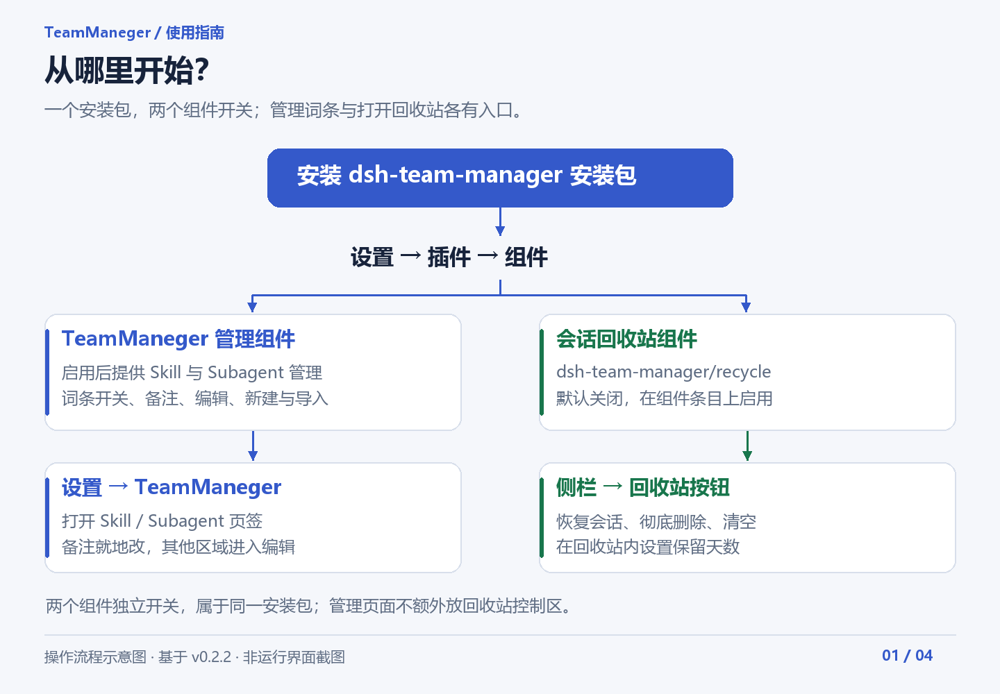
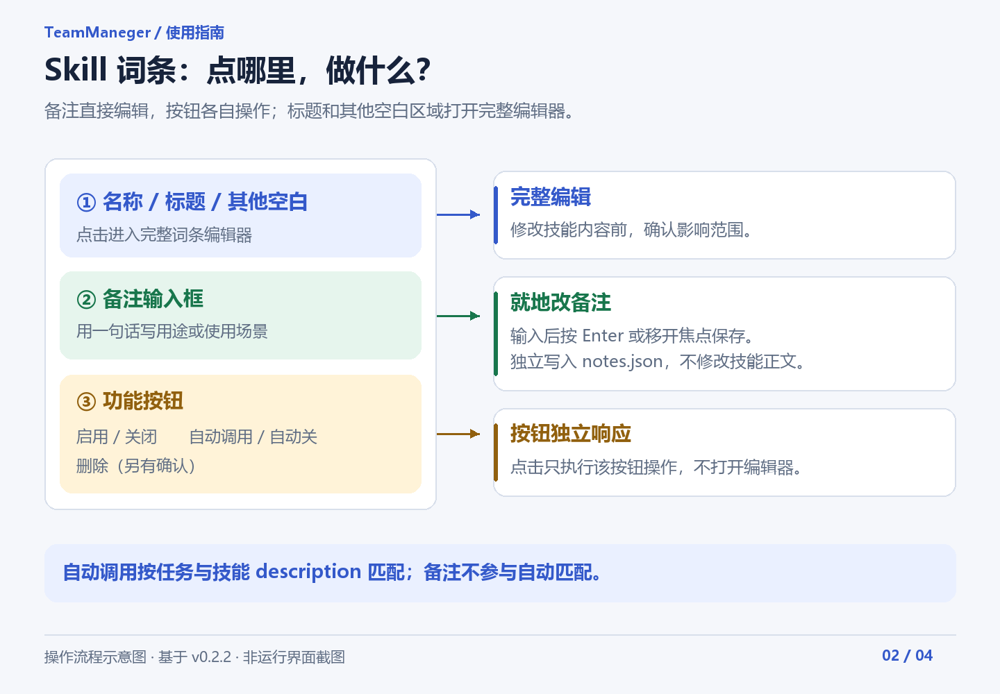
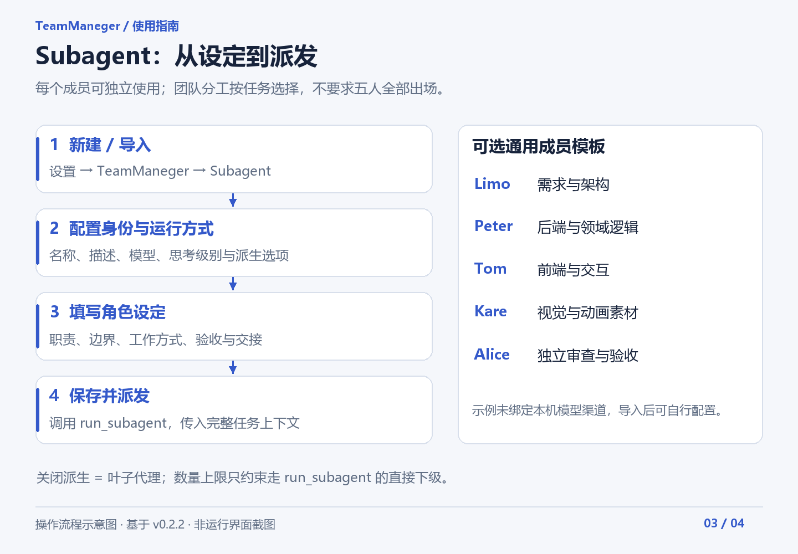
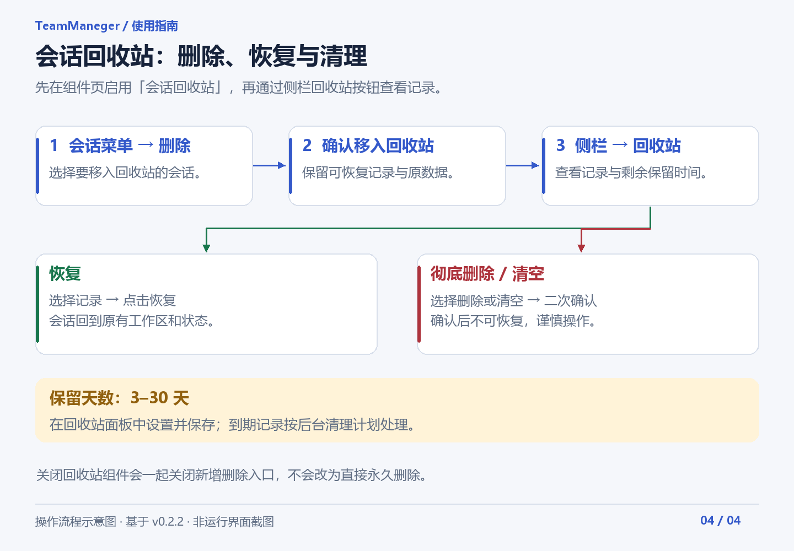

# TeamManeger

**在 DSH 中统一管理 Skill、Subagent 与会话回收站。** 当前版本：**0.2.2**。

一个安装包包含两个组件：**TeamManeger 管理组件**和**会话回收站**。回收站有独立开关，管理页面只保留 Skill 与 Subagent 两个页签。

[下载最新版](https://github.com/lmwzd/dsh-team-manager/releases/latest) · [更新记录](CHANGELOG.md) · [配置与开发说明](docs/DEVELOPMENT.md) · [五人通用模板](examples/agents/README.md)

> 下列图片是按当前操作流程绘制的**操作示意图**，不是运行界面截图；每一步也有文字说明。PNG 便于直接阅读，同目录提供可编辑 SVG。

## 安装后先看这里



1. 从 [GitHub Releases](https://github.com/lmwzd/dsh-team-manager/releases) 下载 `dsh-team-manager-0.2.2.tgz`，通过 DSH 插件管理器安装本地文件。
2. 打开 **设置 → 插件 → 组件**，确认下面两个条目：

   | 组件 | 标识 | 用途 |
   | --- | --- | --- |
   | TeamManeger | `dsh-team-manager` | Skill、Subagent 管理及成员派发 |
   | 会话回收站 | `dsh-team-manager/recycle` | 可恢复的会话删除、恢复与清理；默认关闭 |

3. 管理词条时，打开 **设置 → TeamManeger**。需要回收站时，在**组件页**开启“会话回收站”，再点击**侧栏回收站按钮**。

升级时按安装器要求替换旧包；若返回 `restart-required`，重启 DSH 后刷新页面。已安装旧版 `teammaneger`、SkillManager、SubagentManager 或 `dsh_session_recyclebin` 时，先停用相应独立组件，再启用整合版，避免重复注册工具和路由。

需要 Node.js 20 或更高版本。插件依据实际宿主接口判断兼容性，不要求配置 DSH 版本豁免。

## Skill：编辑、备注与自动调用



进入 **设置 → TeamManeger → Skill**：

| 操作位置 | 结果 |
| --- | --- |
| 名称、标题及其他空白区域 | 打开完整技能编辑器 |
| 备注框 | 直接输入备注；按 Enter 或移开焦点保存 |
| 启用／关闭按钮 | 切换这个技能的启用状态 |
| 自动调用按钮 | 切换本插件的自动调用策略 |
| 删除按钮 | 经确认后删除技能 |

搜索框按**名称与备注**筛选。顶部还提供新建、导入和刷新操作。

删除 Skill 会删除其目录及参考文件，不进入会话回收站；需要保留的技能请先备份。

### 备注和技能内容分开保存

备注只用于记住用途或使用场景，不改技能正文，也不参与自动调用匹配。

- 保存位置：`<skillsDir>/.dsh-team-manager/notes.json`。
- 按技能目录名关联；单行，最多 160 字符。
- 停用或重新启用技能不会删除备注；删除技能时一并清理。
- 可在外部编辑备注文件，再刷新列表。修改已有备注前建议保留备份。

例如：

```json
{
  "version": 1,
  "notes": {
    "frontend-design": "界面设计与改版时使用"
  }
}
```

这里的键是**技能目录名**，通常与技能名称相同。

### 自动调用怎样工作

开启后，本插件向模型提供自动调用策略：模型根据**任务与技能的 description**判断是否应先调用 `skill` 加载完整指令。它依赖模型判断，不是固定关键词路由。

备注不影响该判断。技能停用或声明 `disable-model-invocation: true` 时，不进入附加策略。关闭“自动调用”只撤下本插件的附加要求，宿主仍可能按默认规则或用户点名加载技能。

自动调用开关保存在 `<skillsDir>/.dsh-team-manager/auto.json`，不写入技能正文。

## Subagent：配置成员并派发任务



1. 打开 **设置 → TeamManeger → Subagent**，选择新建或导入。
2. 填写名称、职责描述和角色正文；根据需要指定模型、思考级别及派生选项。
3. 保存后，在对话中按名称派发，例如：“让 alice 审查本次改动，重点检查需求一致性和边界情况”。

每个成员对应 `<agentsDir>/<name>.md`。模型未指定时使用宿主继承策略；派发上下文应包含项目路径、目标、必要资料、修改边界与验收标准，成员不会自动看到主会话全文。新启动的成员读取新设定，已运行会话不会自动替换启动时的人设。

### 可选的五人通用模板

仓库和发布包附带 [examples/agents](examples/agents/README.md)，可按需从导入页面选择：

| 成员 | 适合的任务 |
| --- | --- |
| [Limo](examples/agents/limo.md) | 需求澄清、方案权衡、架构与任务拆分 |
| [Peter](examples/agents/peter.md) | 后端、业务规则、数据与接口实现 |
| [Tom](examples/agents/tom.md) | 页面、交互、渲染与接口接入 |
| [Kare](examples/agents/kare.md) | 视觉方案、美术与动画资源 |
| [Alice](examples/agents/alice.md) | 独立审查、缺陷复现与验收 |

示例未绑定作者本机的模型渠道，不会随插件安装自动覆盖你的成员。导入前先检查已有同名定义；每个成员都可独立工作，不必每次启用整支团队。

### 派生选项

- **关闭“可再派生子代理”**：成员作为叶子代理工作，派生工具会从其会话中移除。
- **开启派生**：`maxChildren` 默认 1，0 表示不限直接下级数量。
- 数量上限只约束通过本插件 `run_subagent` 派发的直接下级；其他派发路径不经此计数。宿主计数接口不可用时会放行。

深度、计数和跨重启恢复的详细边界见[开发说明](docs/DEVELOPMENT.md#subagent-派发边界)。

## 会话回收站：从组件页启用



1. 在 **设置 → 插件 → 组件**启用“会话回收站”，标识为 `dsh-team-manager/recycle`。
2. 在会话菜单中选择删除并确认，会话移入回收站。
3. 点击侧栏回收站按钮，选择恢复、彻底删除，或清空全部记录。
4. 在回收站面板中设置 **3–30 天**保留期并保存；过期记录由后台清理计划处理。

**彻底删除、清空及到期清理后的数据不可恢复。** 手动彻底删除和清空需确认。关闭回收站组件会同时关闭新增删除入口，不会退化成直接永久删除。

整合版继续使用 `<DSH_HOME>/session-delete/trash.json` 和 `logs`，保留旧回收记录与保留天数。不要同时启用旧独立回收站，避免两套实例操作同一份数据。

## 常见问题

**组件页没有“会话回收站”？**

确认安装的是 0.2.1 或更高版本，并在“组件”列表中搜索名称或 `dsh-team-manager/recycle`。安装器要求重启时先重启；Skill／Subagent 管理页面不放回收站开关。

**备注点不进去或点击跳到编辑页？**

0.2.2 已修正点击穿透规则的 CSS 优先级。升级后刷新页面；备注框直接输入，其他空白处进入完整编辑器。

**关掉管理模块，会删除定义吗？**

不会。关闭 Skill 模块会撤下其管理接口与本插件的自动调用策略；关闭 Subagent 模块会撤下管理接口和 `run_subagent`。定义文件仍保留，两个模块都关闭时也能从管理页面重新开启。

**插件自动停用了？**

先检查 DSH 日志里的缺失接口或重复注册原因。停用旧独立插件、解决冲突或升级后，再从组件页启用。普通输入错误和网络失败不应触发兼容性停用。

## 开发与验证

[配置、目录、接口及构建说明](docs/DEVELOPMENT.md) · [更新记录](CHANGELOG.md)

```bash
npm test
```

测试覆盖组件生命周期、旧数据、恢复与清理、备注隔离、自动调用、成员派发与图文说明。测试使用临时目录和宿主替身；页面实际交互仍需在 DSH 中验收。

## 许可证

[MIT](LICENSE)。回收站部分整合自 MIT 许可的 `dsh_session_recyclebin`，原声明保留在 [lib/recycle/LICENSE](lib/recycle/LICENSE)。
